<!-- ───────────── PROFILE CARD ───────────── -->

  

<!-- ───────────── ENCODED NAME (animated) ───────────── -->

  

  
  
  

<code>─────────── ◇ ───────────</code>

## 🎬 The point of view

> **Every big project starts with a tiny “Hello World”.**
> Small steps, a curious mind, and building things that actually work.

Hey, I'm Arthur! I'm a Systems Development student at **ETEC**, and I'm at the very beginning of my path in tech. I learn best by building: I write something, it breaks, I figure out why, and I come out knowing a little more than before.

<code>─────────── ◇ ───────────</code>

## 🧾 Profile

| | |
|:--|:--|
| **ROLE** | Systems Development student |
| **BASED** | Brazil 🇧🇷 |
| **FOCUS** | Python & programming logic |
| **GOAL** | My first opportunity in tech |

  
  

<code>─────────── ◇ ───────────</code>

## 🎨 Production palette

  

Python · Java · PHP · Node.js · TypeScript — tools picked for the job, not for the hype.

<code>─────────── ◇ ───────────</code>

## 🎞️ Featured reels

<!--
  Add your best repos here. Replace REPO-NAME with the repo's real name:

  
-->

*Coming soon: my first projects will show up here as I build them.* 🌱

<code>─────────── ◇ ───────────</code>

## 🐍 Contribution trail

  <picture>
    <source media="(prefers-color-scheme: dark)" srcset="https://raw.githubusercontent.com/ArthurLima223/ArthurLima223/output/github-snake-dark.svg"/>
    
  </picture>

<code>─────────── ◇ ───────────</code>

## 🎬 The next scene

I enjoy learning with people who care about the details, share what they know, and want to ship something useful. If you have tips, a project, or an opportunity, let's talk.

  <a href="https://github.com/ArthurLima223">GitHub</a>
  <!-- · <a href="https://www.linkedin.com/in/SEU-USUARIO">LinkedIn</a> -->
  <!-- · <a href="mailto:seu@email.com">E-mail</a> -->

🇧🇷 Leia em português

 

**O ponto de vista:** todo grande projeto começa com um pequeno “Hello World”.

Oi, eu sou o **Arthur**! Estudo Desenvolvimento de Sistemas na **ETEC** e estou começando minha jornada na tecnologia. Aprendo construindo: faço, quebra, descubro o porquê e sigo sabendo um pouquinho mais.

Agora estou focado em **Python** e em melhorar minha lógica de programação. Meu objetivo é conseguir minha **primeira oportunidade na área de tecnologia**. Fora do código, gosto de jogos e de tecnologia no geral. 🎮

  Arthur Lima · profile made with ♥ and a lot of curiosity 
  

